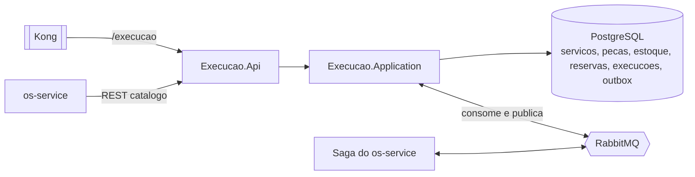

# oficina-execucao-service

Catálogo de serviços/peças, estoque, reserva de peças e fila de execução da oficina — Tech Challenge Fase 4 (SOAT/FIAP). Participa da **Saga orquestrada** do [oficina-os-service](https://github.com/MathboyL3/oficina-os-service) sobre RabbitMQ (MassTransit), com **PostgreSQL** próprio. Arquitetura geral: [`docs/ARQUITETURA-FASE4.md`](https://github.com/MathboyL3/oficina-os-service/blob/main/docs/ARQUITETURA-FASE4.md) no os-service.

## Responsabilidades

- **Catálogo** (serviços e peças): fonte de descrição e preço usada pelo os-service (`GET /api/servicos/{id}`, `GET /api/pecas/{id}`).
- **Estoque:** `EstoquePeca` (com `QuantidadeReservada`) é a fonte da verdade do saldo; `ReservaPeca` (Ativa/Consumida/Liberada) é o rastro por OS, que torna liberar/consumir idempotente. `MovimentacaoEstoque` registra as baixas.
- **Fila de execução** do mecânico (`Execucao`: NaFila → EmDiagnostico/EmReparo → Finalizada | Falhou).
- Banco próprio: PostgreSQL `oficina_execucao`. Nenhum outro serviço o acessa.

## Arquitetura



Camadas: `Execucao.Domain` → `Execucao.Application` (casos de uso, consumidores, contratos) → `Execucao.Infrastructure` (EF Core/Npgsql, MassTransit) → `Execucao.Api`. Swagger na raiz `/`.

## Mensagens

Contratos em `src/Execucao.Application/Contracts/Mensagens.cs` (namespace `Oficina.Contracts`, idêntico nos 3 repos).

| Consome (comando da Saga) | Efeito | Publica |
|---|---|---|
| `ReservarPecas` | reserva **tudo ou nada** (valida saldo antes de mexer); idempotente por OS; recusa se a OS já foi liberada | `PecasReservadas` ou `ReservaPecasFalhou` |
| `EnfileirarExecucao` | cria a `Execucao` na fila (uma por OS, idempotente) | — |
| `LiberarPecas` | compensação: estorna só reservas **Ativas**, grava o marcador de liberação (mesmo sem reservas) e marca a execução em andamento como `Falhou`; sempre confirma | `PecasLiberadas` |

Publicadas pela API (mecânico): `ExecucaoIniciada` (`iniciar`), `ExecucaoFinalizada` (`finalizar`; consome as reservas Ativas de forma atômica, baixando o saldo) e `ExecucaoFalhou` (`falhar`; as peças são liberadas depois, quando a Saga responde com `LiberarPecas`). Peça já consumida não volta ao estoque.

## API

Direto: `http://localhost:5003`; via Kong: `http://localhost:32080/execucao/api/...`. Coleção Postman: [`docs/oficina-execucao-service.postman_collection.json`](docs/oficina-execucao-service.postman_collection.json). Todas exigem JWT.

| Método e rota | Roles |
|---|---|
| `POST /api/servicos` | Gerente |
| `GET /api/servicos` (`?somenteAtivos=`), `GET /api/servicos/{id}` | Atendente, Gerente, Mecanico |
| `PATCH /api/servicos/{id}`, `POST /api/servicos/{id}/inativar` | Gerente |
| `POST /api/pecas`, `PATCH /api/pecas/{id}/valor`, `POST /api/pecas/{id}/inativar` | Gerente |
| `GET /api/pecas` (`?somenteAtivas=`), `GET /api/pecas/{id}` | Atendente, Gerente, Mecanico |
| `POST /api/pecas/{id}/reabastecer` | Gerente, Atendente |
| `GET /api/execucoes` (fila: prioridade desc, mais antigas primeiro), `GET /api/execucoes/{id}` | Mecanico, Gerente |
| `POST /api/execucoes/{id}/iniciar`, `/diagnostico` (`{observacoes}`), `/finalizar`, `/falhar` (`{motivo}`) | Mecanico, Gerente |
| `GET /health/live`, `GET /health/ready` (Postgres + RabbitMQ) | anônimo |

## Configuração

| Chave (env com `__`) | Uso |
|---|---|
| `ConnectionStrings__Postgres` | Postgres `oficina_execucao` (migrations no startup, com lock) |
| `RabbitMq__Host/Port/VirtualHost/Username/Password` | `localhost`/`5672`/`/`/`guest`/`guest` |
| `Jwt__Issuer/Audience/Secret` | mesmos do os-service (este serviço só valida o token) |
| `NEW_RELIC_LICENSE_KEY` | habilita o agente APM |

Segredos vêm de variável de ambiente / Secret do Kubernetes; o segredo do `appsettings.Development.json` é só de desenvolvimento.

## Rodando localmente

Requer Docker. Os 3 serviços compartilham a rede externa `oficina-dev` (os containers se enxergam pelo nome):
1. Uma vez: `docker network create oficina-dev`
2. Suba o **os-service primeiro** (traz o RabbitMQ): `docker compose up -d --build` em `oficina-os-service`
3. Depois `oficina-execucao-service` e `oficina-billing-service` (mesmo comando).

URLs: os `http://localhost:5001`, billing `http://localhost:5002`, execucao `http://localhost:5003` (Swagger em `/`, `/health/ready`). RabbitMQ management: http://localhost:15672 (guest/guest). Postgres do execucao: porta host 5434. Cadastre ao menos um serviço e uma peça (com estoque) aqui antes de montar os itens de uma OS no os-service.

## Testes e cobertura

`dotnet test Execucao.slnx` exige >= 80% de linhas e **precisa de Docker** (Testcontainers/Postgres).

Evidência (execução real de `dotnet test Execucao.slnx` em 2026-11-14; 114 testes, 0 falhas):

```
+-------------------------+--------+--------+--------+
| Module                  | Line   | Branch | Method |
+-------------------------+--------+--------+--------+
| Execucao.Api            | 95.06% | 90%    | 100%   |
+-------------------------+--------+--------+--------+
| Execucao.Application    | 93.23% | 93.33% | 76.34% |
+-------------------------+--------+--------+--------+
| Execucao.Domain         | 78.51% | 52.27% | 80%    |
+-------------------------+--------+--------+--------+
| Execucao.Infrastructure | 99%    | 94.44% | 97.91% |
+-------------------------+--------+--------+--------+

+---------+--------+--------+--------+
|         | Line   | Branch | Method |
+---------+--------+--------+--------+
| Total   | 89.04% | 75.72% | 83.84% |
+---------+--------+--------+--------+
| Average | 91.45% | 82.51% | 88.56% |
+---------+--------+--------+--------+
```

## Deploy no Kubernetes

Pré-requisitos:
- `fiap-infra-k8s` aplicado (namespace `oficina`, RabbitMQ com o Secret `rabbitmq-credentials` e as rotas do Kong).
- Variáveis de ambiente: `EXECUCAO_DB_PASSWORD`, `JWT_SECRET`, `NEW_RELIC_LICENSE_KEY`, `GHCR_USER` e `GHCR_TOKEN` (PAT com `read:packages`).

Passos (a partir da raiz do repo):
1. `./k8s/bootstrap-secrets.ps1` — cria/atualiza os Secrets e o `ghcr-pull` de forma idempotente (falha se uma env obrigatória estiver vazia). `k8s/secret.example.yaml` documenta as chaves.
2. `kubectl apply -k k8s/`

**Notas:** o Postgres próprio roda em `k8s/postgres.yaml`. A senha aparece em dois Secrets (`POSTGRES_PASSWORD` em `execucao-postgres-secret` e dentro da connection string em `oficina-execucao-service-secrets`). O bootstrap deriva ambos de `EXECUCAO_DB_PASSWORD`; para rotacionar, rode o bootstrap de novo (e reinicie o Postgres/pods, pois a senha só vale na criação do volume). Acesso externo pelo Kong (NodePort **32080**): `/execucao/api/...`. RabbitMQ UI no cluster: NodePort **31672**.

## CI/CD

Pipeline em `.github/workflows/ci-cd.yml` (GitHub Actions).

| Job | Quando | O que faz |
|-----|--------|-----------|
| `build-test-sonar` | PR e push na `main` | restore, build Release, `dotnet test` com gate de cobertura >= 80% (coverlet; sempre ativo) e, se `SONAR_TOKEN` existir, análise SonarCloud com quality gate. Publica o artifact `coverage`. |
| `image` | push na `main` | build da imagem Docker e push para o GHCR (`:<sha>` e `:latest`, nome em minúsculas) via `GITHUB_TOKEN`. |
| `deploy` | push na `main`, após `image` | runner self-hosted (`environment: producao`): fixa a tag `<sha>` no `k8s/kustomization.yaml`, `kubectl apply -k k8s/` e `rollout status`. |

**Secrets/vars necessários**
- `secrets.SONAR_TOKEN` (opcional: sem ele a análise Sonar é pulada), `vars.SONAR_PROJECT_KEY`, `vars.SONAR_ORGANIZATION`.
- Environment `producao` (pode exigir aprovação manual).
- `GITHUB_TOKEN` (automático) com `packages: write` para publicar no GHCR.
- Deploy: runner self-hosted com `kubectl` apontando para o cluster (docker-desktop), `fiap-infra-k8s` aplicado e `k8s/bootstrap-secrets.ps1` já executado.

**Proteger a `main` (passo manual, não configurável por arquivo):** Settings → Branches → Add rule para `main`: *Require a pull request before merging* e *Require status checks to pass* com o check `build-test-sonar`.
